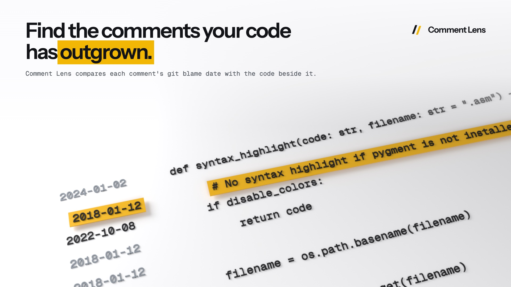

# Comment Lens

[](https://comment-lens-review.vercel.app/demo.mp4)

Comment Lens is a checker for code comments. It uses git history to find the ones a person should read again: tasks with no follow-up, links to files that no longer exist, and comments whose nearby code changed after they were written. The CLI and the CI checks run locally and upload nothing. A hosted workspace shows each finding with its source context and scanner evidence and records review decisions, and a VS Code adapter shows the same findings beside the code. Nothing in the project edits your repository files.

## What it finds

This comment in pwndbg was written in January 2018, above a check for a missing Pygments. In October 2022 a cleanup commit replaced that check with a plain import. The comment stayed. Comment Lens reads both dates from `git blame` and reports the comment with the evidence.


It reports a comment only when the code change added or removed a word or number the comment mentions. Whitespace-only edits, commits listed in `.git-blame-ignore-revs` and banner comments do not count. The home page lists all [eleven rules](https://comment-lens-review.vercel.app/#rules), and [Maintenance findings and history](docs/maintenance.md) explains how the maintenance rules decide.

## Try it

```bash
python3 -m pip install comment-lens-scanner
comment-lens check .
```

The scanner needs Python 3.12 or newer. `check` prints a Markdown report and exits 0 until you set a blocking threshold with `--fail-on`.


This is a real run on pallets/flask with scanner 0.1.1: a check that exits 1, then a baseline that brings the same check to exit 0. The typing is automated and the output is not. The [full video](https://comment-lens-review.vercel.app/demo.mp4) has playback controls.

## Adopt it without fixing the backlog

The first run on an old repository reports more than anyone fixes in one pull request. A baseline records those findings once, and after that only new findings can fail a build. On pwndbg, a full scan with `--fail-on high` blocks on 53 findings. With a baseline recorded on 2026-09-14, it blocks on the 14 FIXME comments added since.


[CI checks and baselines](docs/ci.md) covers the baseline file, the pre-commit hook and the GitHub Actions workflow.

## Architecture

- Landing page: a static home page at `/` that follows one real pwndbg comment through its git history until Comment Lens flags it, plus a page for each rule at `/rules/<rule>`. The code, dates and findings come from `git blame` and real CLI runs; see [Landing page data](docs/landing-data.md).
- Review workspace: a Next.js App Router interface at `/workspace` for repository scans, evidence inspection, review decisions, export and maintenance history.
- Scanner: a Python package that extracts comments with Tree-sitter, falling back to Pygments, along with short code context within the retention limits.
- Worker and ingestion: a signed ingestion pipeline and a control-plane dispatch workflow for asynchronous repository analysis.
- Database: a Drizzle ORM schema on PostgreSQL for scan metadata and comment records.

## Project structure

```
├── app/                  # Next.js App Router routes and layouts
├── components/           # Review workspace UI
├── contracts/            # Type definitions and request/response contracts
├── db/                   # Drizzle ORM schema, migrations, and database client
├── lib/                  # Shared utilities and server helpers
├── scanner/              # Python Tree-sitter comment extraction engine
├── editor/vscode/         # Local VS Code diagnostics adapter
├── tests/                # Unit, integration, and performance tests
└── worker/               # Ingestion upload and failure notification scripts
```

## Getting started

### Prerequisites

- Node.js >= 24 (< 27)
- pnpm >= 11
- Python >= 3.12 (for the scanner); Python >= 3.11 for worker scripts

### Local comment checks

Install the released scanner with Python 3.12 or newer:

```bash
python3 -m pip install comment-lens-scanner
```

To run the code in this checkout instead, use `python3 -m pip install ./scanner`.

Run `comment-lens scan` from a Git repository to write compatible
`.comment-lens/scan.json` and `.comment-lens/comments.ndjson` artifacts. Run
`comment-lens check` to print a Markdown maintenance report, or use
`--format json` or `--format sarif`. Use `comment-lens export` to render
an existing local scan in any of those formats.

```bash
comment-lens scan .
comment-lens check . --changed origin/main...HEAD --fail-on high
comment-lens check . --changed HEAD --scope files --format sarif --output findings.sarif
comment-lens export . --format json
```

`--changed` accepts a Git base ref or a range ending at the checked-out
`HEAD`. By default, `check` reports only comments touching changed
lines; `--scope files` reports every comment in changed files. A single
base ref includes tracked working-tree changes. Add `--include-untracked`
for a full scan that includes untracked files. This option cannot be combined
with `--changed`. Deleted lines and files have no current comments to
report.

The CLI runs locally and makes no upload request. It uses installed Tree-sitter
grammars when available locally and otherwise uses Pygments. It does not
download grammars during a check. Source files are read, not executed.

Place a `.comment-lens.toml` file at the repository root to choose
exclusions and policy. Paths are relative to that root; the built-in
generated-file and dependency exclusions still apply.

```toml
version = 1
exclude = ["fixtures", "legacy"]

[policy]
fail_on = "none"

[policy.rules]
todo = "review"
fixme = "high"
hack = "high"
restates_symbol = "low"
excessive_verbosity = "low"
hedge_stack = "low"
promotional_or_vague_language = "low"

[thresholds]
max_words = 100
hedge_terms = 3
```

Set a rule to `off`, or override `fail_on` for one run with
`--fail-on low|review|high`. Findings are advisory by default.
Exit status `0` means the check completed without blocking findings;
`1` means findings met the chosen blocking severity; `2` means
configuration, extraction, or artifact handling failed. `check` and
`compare` also print that result on one line to stderr. The existing
`comment-lens-scan` command remains available for the hosted worker.

More documentation:

- [CI checks and baselines](docs/ci.md): a pre-commit hook, baselines, pull request annotations and scheduled checks.
- [Maintenance findings and history](docs/maintenance.md): comment age, local references and history across scans.
- [Assisted review](docs/assisted-review.md): optional Gemini guidance for one finding in the hosted workspace.
- [Editor integration](docs/editor.md): local findings beside comments in Visual Studio Code.
- [Hosted API](docs/api.md): bearer authentication, scripted hosted scans and account-wide scan commands.
- [Landing page data](docs/landing-data.md): how the home page's sample report was produced.

### Installation

```bash
pnpm install
```

### Development

```bash
pnpm dev
```

### Configuration

Copy `.env.example` to `.env.local` and replace every placeholder with a local
value. Keep secrets and private keys out of source control. The production
deployment uses the same variable names in Vercel; set them in the appropriate
environment instead of committing a `.env` file.

The scan control plane dispatches the workflow in this repository:

```text
owner: Builder106
repository: comment-lens
workflow: comment-lens-scan.yml
ref: main
upload base URL: https://comment-lens-review.vercel.app
```

The four `COMMENT_LENS_WORKFLOW_*` values are required. The application fails
closed with a 503 before creating a scan if any is missing. A workflow dispatch
failure after scan creation marks that scan as failed.

### Verification and testing

```bash
pnpm run typecheck
pnpm run lint
pnpm run test
pnpm run test:coverage
pnpm run build
python3 -m pytest scanner/tests
python3 -m unittest discover worker -p 'test_*.py'
pnpm run db:migrate
pnpm run test:integration
pnpm run test:performance
```

The integration and performance suites require a reachable PostgreSQL database.
Set `DATABASE_URL` for the performance suite. The integration fixture may use
`COMMENT_LENS_TEST_DATABASE_URL` instead. The performance test writes its JSON
artifact under `tests/performance/artifacts/`.

### Deployment runbook

#### Vercel runtime variables

Configure these in Vercel without exposing their values:

- `DATABASE_URL`
- `SESSION_SECRET`
- `ALLOWED_GITHUB_USER_ID`
- `COMMENT_LENS_API_TOKEN_SHA256` and `COMMENT_LENS_API_LOGIN` (optional, for programmatic access)
- `COMMENT_LENS_GITHUB_ORGANIZATIONS` (optional, for explicitly allowed organization installations)
- `GITHUB_APP_CLIENT_ID`
- `GITHUB_APP_CLIENT_SECRET`
- `GITHUB_APP_ID`
- `GITHUB_APP_PRIVATE_KEY`
- `WORKER_INGEST_SECRET`
- `CRON_SECRET`
- `COMMENT_LENS_WORKFLOW_OWNER`
- `COMMENT_LENS_WORKFLOW_REPOSITORY`
- `COMMENT_LENS_WORKFLOW_ID`
- `COMMENT_LENS_WORKFLOW_REF`
- `GEMINI_API_KEY_1` through `GEMINI_API_KEY_4` (optional, tried in order when a project returns HTTP 429)
- `GEMINI_API_KEY` (optional legacy single-key fallback when no numbered keys are set)
- `GEMINI_MODEL` (optional)

Set `COMMENT_LENS_UPLOAD_BASE_URL` as a GitHub Actions repository variable to
the production URL. The production workflow target values are
`Builder106`, `comment-lens`, `comment-lens-scan.yml`, and `main`.

Production is the default scan target. Set
`COMMENT_LENS_WORKFLOW_TARGET=development` in a local or preview control plane
to send scans to the development endpoint. Set the GitHub Actions variable
`COMMENT_LENS_DEV_UPLOAD_BASE_URL` to that endpoint and the secret
`COMMENT_LENS_DEV_INGESTION_SIGNING_SECRET` to its signing key. The development
deployment must use the same key as `WORKER_INGEST_SECRET` and point
`DATABASE_URL` at the development database.

#### GitHub Actions variables and secrets

The `comment-lens-scan.yml` workflow requires these repository settings:

- Secret `COMMENT_LENS_GITHUB_APP_ID`
- Secret `COMMENT_LENS_GITHUB_APP_PRIVATE_KEY`
- Secret `COMMENT_LENS_INGESTION_SIGNING_SECRET`
- Variable `COMMENT_LENS_UPLOAD_BASE_URL`

The App used by the web control plane needs permission to dispatch the
`comment-lens-scan.yml` workflow in the Comment Lens repository. Its scanner
workflow token uses read-only Contents permission and must be installed on each
target repository that can be scanned. The installation account must be visible
to the authorized GitHub user. The workflow checks out the trusted scanner from
Comment Lens, then checks out the selected target repository with the App token;
it does not modify target repositories.

#### Database migration

Vercel production builds apply committed Drizzle migrations before building the
app. Preview builds skip migrations. For manual migrations in another
environment, set `DATABASE_URL` to the target PostgreSQL database and run:

```bash
pnpm install --frozen-lockfile
pnpm run db:migrate
```

Do not run `db:generate` in production unless the schema change is
intentional and the resulting migration is reviewed and committed first.

#### Production smoke test

After deployment and configuration verification, use an authorized account:

1. Open `/workspace`, connect GitHub, and confirm the target repository is available. The home page is a public project page and does not sign anyone in.
2. Start a scan for `Builder106/comment-lens` on `main`.
3. Confirm the `comment-lens-scan.yml` workflow run starts and completes.
4. Confirm signed chunks are accepted and the scan count matches the manifest.
5. Confirm the review queue loads, a review decision persists, and duplicate
   chunk delivery remains idempotent.
6. Request the optional Gemini assessment if a numbered Gemini key or
   `GEMINI_API_KEY` is configured.
7. Export the scan as JSON and confirm the download completes.

#### Failure, retry, and retention behavior

If dispatch fails, the scan is marked failed and the workspace lets you start
another scan. If parsing or upload fails, the workflow's failure job notifies the
control plane and marks the scan failed. Review the GitHub Actions run before
retrying; retries create a new scan attempt rather than changing a completed
scan.

The daily Vercel Cron job deletes expired scans, chunks, and comments. It also
removes review decisions and identities that no retained scan references.
Gemini assessments expire with their scan. Set `CRON_SECRET` in Vercel so the
scheduled request is authenticated. GitHub Actions artifacts expire after one
day. Comment Lens stores comments and short source context only and never
modifies target repositories.

## License

MIT
