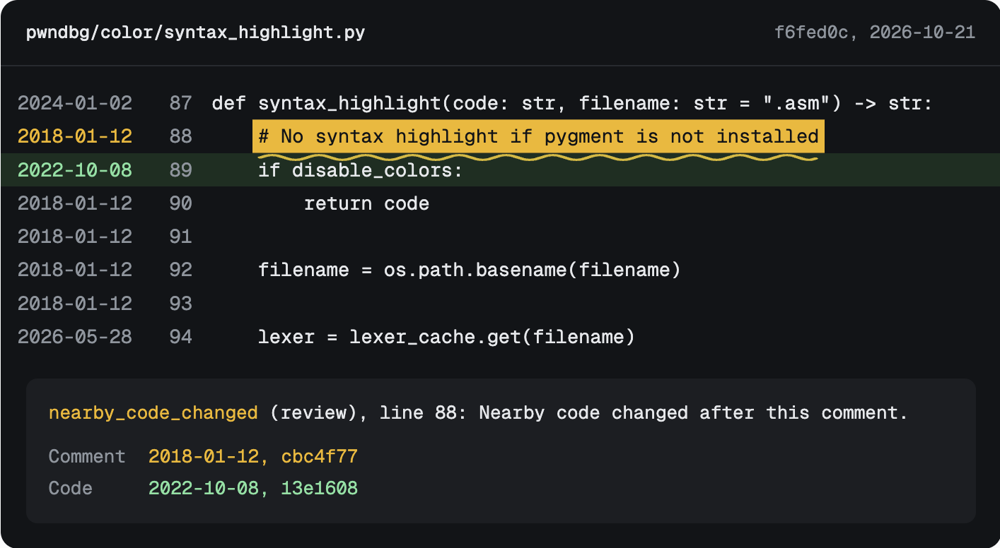
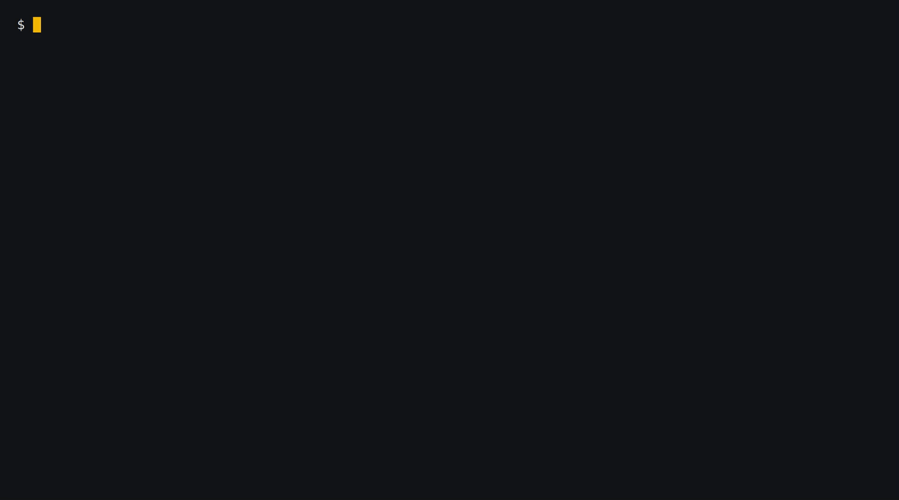
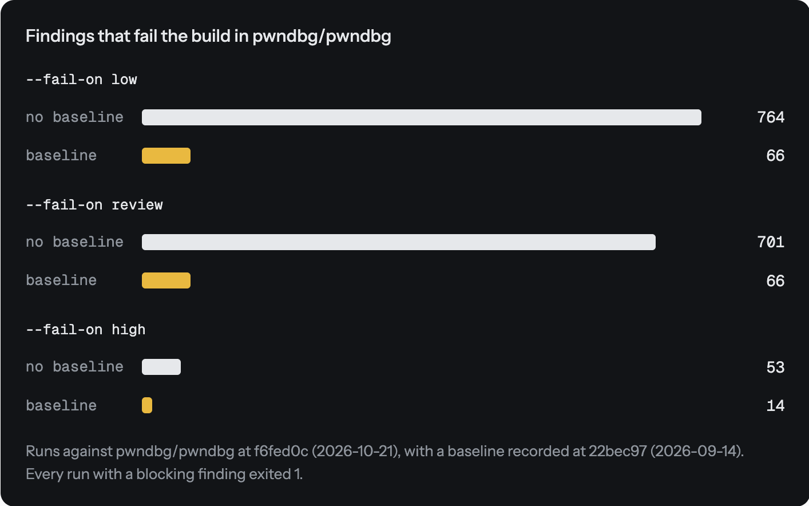

# Comment Lens

[](https://comment-lens-review.vercel.app/demo.mp4)

Comment Lens is a checker for code comments. It uses git history to find the ones a person should read again: tasks with no follow-up, links to files that no longer exist, and comments whose nearby code changed after they were written. The CLI and the CI checks run locally and upload nothing. A hosted workspace shows each finding with its source context and scanner evidence and records review decisions, and a VS Code adapter shows the same findings beside the code. Nothing in the project edits your repository files.

## What it finds

This comment in pwndbg was written in January 2018, above a check for a missing Pygments. In October 2022 a cleanup commit replaced that check with a plain import. The comment stayed. Comment Lens reads both dates from `git blame` and reports the comment with the evidence.



It reports a comment only when the code change added or removed a word or number the comment mentions. Whitespace-only edits, commits listed in `.git-blame-ignore-revs` and banner comments do not count. The home page lists all [eleven rules](https://comment-lens-review.vercel.app/#rules), and [Maintenance findings and history](docs/maintenance.md) explains how the maintenance rules decide.

## Try it

```bash
python3 -m pip install comment-lens-scanner
comment-lens check .
```

The scanner needs Python 3.12 or newer. `check` prints a Markdown report and exits 0 until you set a blocking threshold with `--fail-on`.



This is a real run on pallets/flask: a check that exits 1, then a baseline that brings the same check to exit 0. The waits while it scans are sped up. The [full video](https://comment-lens-review.vercel.app/demo.mp4) has playback controls.

## Adopt it without fixing the backlog

The first run on an old repository reports more than anyone fixes in one pull request. A baseline records those findings once, and after that only new findings can fail a build. On pwndbg, a full scan with `--fail-on high` blocks on 53 findings. With a baseline recorded on 2026-09-14, it blocks on the 14 FIXME comments added since.



[CI checks and baselines](docs/ci.md) covers the baseline file, the pre-commit hook and the GitHub Actions workflow.

## Architecture

The Python scanner extracts comments and reports findings. A hosted workspace supports repository scans and review decisions, and a VS Code adapter shows findings beside the code. A worker handles hosted scans, and PostgreSQL stores scan metadata and comment records.

## More ways to use the scanner

To run the scanner from this checkout, use `python3 -m pip install ./scanner`.

```bash
comment-lens check . --changed origin/main...HEAD --fail-on high
comment-lens export . --format json
```

The [local scanner guide](docs/cli.md) covers scan artifacts, output formats, changed-file checks, configuration, and exit codes.

More documentation:

- [CI checks and baselines](docs/ci.md): a pre-commit hook, baselines, pull request annotations and scheduled checks.
- [Maintenance findings and history](docs/maintenance.md): comment age, local references and history across scans.
- [Assisted review](docs/assisted-review.md): optional Gemini guidance for one finding in the hosted workspace.
- [Editor integration](docs/editor.md): local findings beside comments in Visual Studio Code.
- [Hosted API](docs/api.md): bearer authentication, scripted hosted scans and account-wide scan commands.
- [Landing page data](docs/landing-data.md): how the home page's sample report was produced.
- [Deployment runbook](docs/deployment.md): hosted configuration, migrations, and production checks.

## Development

To work on the hosted app and worker, you need Node.js >= 24 (< 27), pnpm >= 11, and Python >= 3.11 for worker scripts. The scanner needs Python >= 3.12.

### Installation

```bash
pnpm install
```

### Run locally

```bash
pnpm dev
```

### Configuration

Copy `.env.example` to `.env.local` and replace every placeholder with a local
value. Keep secrets and private keys out of source control. The production
deployment uses the same variable names in Vercel; set them in the appropriate
environment instead of committing a `.env` file.

### Verification and testing

```bash
pnpm run typecheck
pnpm run lint
pnpm run test
pnpm run test:coverage
pnpm run build
python3 -m pytest scanner/tests
python3 -m unittest discover worker -p 'test_*.py'
pnpm run db:migrate
pnpm run test:integration
pnpm run test:performance
```

The integration and performance suites require a reachable PostgreSQL database.
Set `DATABASE_URL` for the performance suite. The integration fixture may use
`COMMENT_LENS_TEST_DATABASE_URL` instead. The performance test writes its JSON
artifact under `tests/performance/artifacts/`.


## License

MIT
