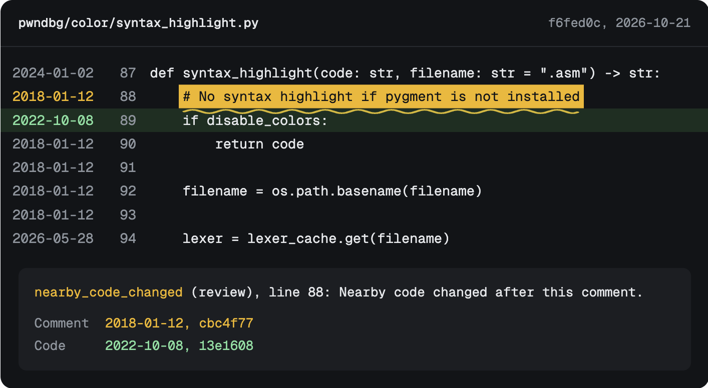

# Comment Lens Scanner

Comment Lens extracts code comments for review. The local command-line interface flags comments that may need attention, explains each finding with deterministic rule evidence, and leaves repository files unchanged.

## What it finds

This pwndbg comment was written in 2018, above a check for a missing Pygments. A 2022 cleanup commit replaced that check with a plain import, and the comment stayed. Comment Lens reads both dates from `git blame` and reports the comment with the evidence.



## Features

- Parsing: Tree-sitter grammars, with a Pygments fallback, separate docstrings, line comments, inline notes and header blocks.
- Maintenance signals: flags unresolved `TODO`, `FIXME` and `HACK` comments, comments that repeat a symbol name, comments near changed code, and broken local file links.
- Git checks: `--changed` limits a pre-commit or CI check to comments added or modified on the current branch.
- Export: JSON, NDJSON, Markdown and SARIF, which GitHub Actions can turn into pull request annotations.
- Local by default: reads code without executing it and sends nothing to external servers.

## Installation

Install the scanner from PyPI. It needs Python 3.12 or newer.

```bash
python3 -m pip install comment-lens-scanner
```

To run the code in a checkout of the repository instead, use `python3 -m pip install ./scanner` from the repository root.

## Usage

### Scan a repository

Scan the current repository and generate local finding manifests (`.comment-lens/scan.json` and `.comment-lens/comments.ndjson`):

```bash
comment-lens scan .
```

### Check changed comments

Check only comments on lines changed between `origin/main` and `HEAD`. The command exits 1 if a high-severity finding is introduced:

```bash
comment-lens check . --changed origin/main...HEAD --fail-on high
```

Generate SARIF output for CI integration:

```bash
comment-lens check . --changed HEAD --scope files --format sarif --output findings.sarif
```

### Export an existing scan

Convert an existing scan artifact into Markdown or JSON:

```bash
comment-lens export . --format markdown
comment-lens export . --format json
```

### Adopt it with a baseline

Record the current findings once, then let only new findings fail a build:

```bash
comment-lens baseline create . --output .comment-lens-baseline.json
comment-lens compare . --baseline .comment-lens-baseline.json --fail-on high
```

See [CI checks and baselines](https://github.com/Builder106/comment-lens/blob/main/docs/ci.md) for the pre-commit hook and the GitHub Actions workflow.

## Configuration

Place a `.comment-lens.toml` file at your repository root to configure exclusions and rule policies:

```toml
version = 1
exclude = ["fixtures", "legacy"]

[policy]
fail_on = "none"

[policy.rules]
todo = "review"
fixme = "high"
restates_symbol = "review"
missing_local_reference = "high"
```

## License

MIT License. See [LICENSE](https://github.com/Builder106/comment-lens/blob/main/LICENSE) for details.
